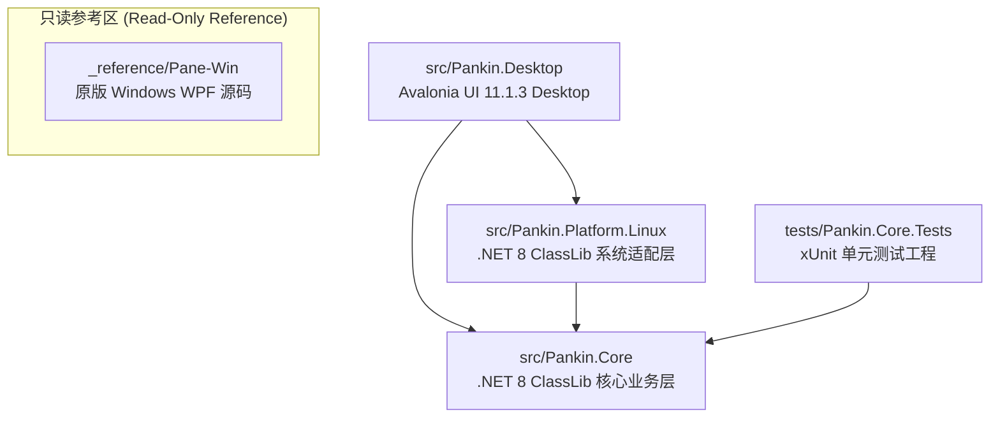

# Pankin (Linux 桌面效率平台) 全景架构与工程上下文上下文规范 (PROJECT_CONTEXT.md)

> **文档定位与使用指引**：  
> 本文档是 **Pankin** 项目的全景工程规范、核心架构剖析与底层技术细节全集。专门用于作为上下文提示词（Context Injection）上传或粘贴给网页端顶尖大模型（ChatGPT-4o/o1、Claude 3.5 Sonnet、Gemini 1.5 Pro 等），使 AI 能够作为 **Pankin 首席架构师兼 Linux 原生桌面系统级全栈专家**，零偏差、高质量地指导代码编写、架构演进与 Bug 排查。

---

## 一、项目基本概况与架构定位

### 1.1 项目起源与愿景
* **前身与参考**：项目脱胎于优秀的 Windows 桌面效率工具 `LBEILC/Pane`（基于 WPF、.NET Framework/.NET Core 及大量 Windows 专有 Win32 API 构建）。工作区根目录下的 `_reference/Pane-Win` 包含了原版完整源码，**仅作为只读参考区**（用于对照功能交互、UI 布局、业务状态流转与数据结构），**严禁直接复制任何 Windows 原生实现**。
* **原生移植目标**：将工具原生重构并移植到 **Linux 桌面平台**（首要基准与深度验证环境为 **Ubuntu 24.04 LTS**，同时兼容主流 GNOME Wayland / X11 桌面会话）。
* **核心定位**：打造集 **全盘/应用极速启动器（Launcher）**、**SQLite 剪贴板历史管理（Clipboard）**、**鼠标全局手势（Gestures）**、**左键划词跟随智能超级面板（SuperPanel）**、**AI 多轮流式对话与划词翻译（Ai / Translation）**、**目录快速穿梭（FolderJump）** 与 **批量重命名（BatchRename）** 于一体的 Linux 原生现代生产力桌面终端。

### 1.2 三层解耦架构设计（Clean Architecture）
Pankin 采用严格的关注点分离与单向依赖分层架构（工程解文件为 `Pankin.sln`）：



各层职责边界清晰分明：
1. **`src/Pankin.Core` (目标框架: `net8.0`, classlib)**：
   * **纯业务逻辑与平台中立抽象**。定义了 4 大核心跨平台接口（`IAppScanner`、`IFileSearcher`、`IClipboardService`、`IGlobalInputHook`）及 `IAutostartService`、`ILauncherActionHost`。
   * 包含启动器多源检索引擎（`LauncherSearch`）、拼音匹配与注音字典（`PinyinMatcher`）、算式即时计算（`CalculatorService`）、关机倒计时（`PowerTimerService`）、终端服务（`TerminalService`）、SQLite 剪贴板存储（`ClipboardStorage`）、AI 流式对话与翻译（`AiService`、`TranslationService`）、手势识别状态机（`GestureRecognizer`）、划词去抖过滤（`SelectionDebounceFilter`）、配置管理（`SettingsStore`）以及多语言国际化（`Strings`）。
   * **绝对不依赖**任何具体的操作系统库、X11/Wayland 绑定或 UI 框架（Avalonia/WPF）。
2. **`src/Pankin.Platform.Linux` (目标框架: `net8.0`, classlib)**：
   * **Ubuntu 24.04 / Linux 平台专属底层交互层**。实现 `Pankin.Core` 中定义的所有硬件、系统与桌面抽象接口。
   * 引用 `SharpHook 5.3.8`（libuiohook 的跨平台 C# 封装）实现全局按键与鼠标事件监听；实现 GNOME Wayland 全局热键动态穿透；实现 XDG Desktop 规范应用递归扫描与 `.desktop` 解析；调用 `plocate` 管道实现子毫秒级文件搜索；处理 Wayland / XWayland 剪贴板读取并彻底根除 Wayland 下后台轮询导致的 Dock 图标闪烁；实现基于 `gio`/`xdg-open` 的外部应用与终端启动。
3. **`src/Pankin.Desktop` (目标框架: `net8.0`, WinExe/Avalonia Desktop App)**：
   * **Avalonia 11 现代桌面前端**。采用 MVVM 架构，集成 `CommunityToolkit.Mvvm 8.2.2`。
   * 拥有统一的现代化设计系统 —— **"Graphite Glass"**（支持深色/浅色主题、毛玻璃透明度调节、强调色切换与统一圆角规范）。
   * 包含 7 大核心窗口：主启动器窗口（`MainWindow`）、剪贴板历史窗口（`ClipboardWindow`）、划词与 AI 超级面板（`SuperPanelWindow`）、鼠标手势轨迹指示窗口（`GestureOverlayWindow`）、系统设置中心（`SettingsWindow`）、依赖自检向导（`SetupWindow`）与批量重命名工具（`RenameWindow`）。
   * 管理系统托盘（`TrayIcon`）、窗口失焦隐藏（Hide-on-deactivate）、热键防抖节流以及多窗口状态调度。
4. **`tests/Pankin.Core.Tests` (目标框架: `net8.0`, xUnit)**：
   * 核心业务测试套件，拥有 **349 个高覆盖率单元测试**，涵盖启动器评分排序、拼音匹配、去重逻辑、剪贴板存取、手势识别、划词去抖、配置持久化与依赖检测，确保 100% 稳定运行。

---

## 二、绝对红线与开发规范

在为 Pankin 贡献或生成任何代码时，必须**无条件遵守**以下架构红线与质量准则：

### 2.1 绝对禁止引入 Windows 专属组件
* **禁止命名空间**：绝对不得在 `src/` 下引入任何 `System.Windows.*`（WPF/WinForms 专有）或 `Microsoft.Win32.*` 命名空间。
* **禁止 P/Invoke Windows DLL**：严禁出现任何针对 `user32.dll`、`kernel32.dll`、`gdi32.dll`、`shell32.dll`、`dwmapi.dll`、`ole32.dll` 等 Windows 原生动态库的 `[DllImport]` 或 `[LibraryImport]`。
* **解耦原则**：任何涉及操作系统差异的能力（如窗口枚举、快捷键、文件探测、电源控制、进程启动），**必须**在 `Pankin.Core.Abstractions` 中定义契约接口，由 `Pankin.Platform.Linux` 实现，绝不允许直接在 Desktop 或 Core 中编写硬编码的平台分支。

### 2.2 Linux (Wayland / X11) 双环境兼容规范与已知陷阱

| 场景 / 痛点 | Linux 底层限制与陷阱 | Pankin 的工程化解决方案 |
| :--- | :--- | :--- |
| **Wayland 全局快捷键失效** | Ubuntu 24.04 默认使用 GNOME Wayland。Wayland 严格的进程隔离机制使得传统的全局按键监听库（如 `libuiohook`）在其他应用程序处于活动焦点时无法稳定捕获全局快捷键。 | **双轨容灾机制 (`LinuxInputHook.cs`)**：<br/>1. 检测到 GNOME/Ubuntu 桌面时，通过 `gsettings` 动态向 `org.gnome.settings-daemon.plugins.media-keys.custom-keybinding` 注册系统原生快捷键。<br/>2. 快捷键触发时运行微型命令，向本地 UDP 端口 `127.0.0.1:49182` 发送数据报（如 `ToggleLauncher`、`ToggleClipboard`）。<br/>3. 后台 UDP 守护协程接收到报文后触发对应的全局事件。<br/>4. 同时保持 `SharpHook (TaskPoolGlobalHook)` 在 X11 会话下的原生捕获能力。 |
| **GNOME Wayland 剪贴板 Dock 图标闪烁** | 在 GNOME Wayland 下，`wl-paste` 由于缺乏 `wlr-data-control` 协议支持，每次被子进程调用读取剪贴板时，合流器都会为其生成一个无标题的临时顶层 surface，若后台周期性轮询，会导致 Ubuntu 系统的 Dock 任务栏不断闪现应用图标并立即消失。 | **无感防闪剪贴板 (`LinuxClipboardService.cs`)**：<br/>1. 启动时检查环境变量 `DISPLAY` 与 `WAYLAND_DISPLAY`。<br/>2. 凡存在 `DISPLAY`（含 XWayland 兼容层），优先使用静默无窗口的 `xclip -o -selection clipboard` 读取剪贴板，彻底杜绝 Dock 闪现。<br/>3. 仅当无 X11 显示服务且存在纯 Wayland 时才降级调用 `wl-paste --no-newline`。 |
| **本地文件毫秒级检索** | Linux 下不存在 Windows Everything SDK 原生支持，直接遍历全盘文件系统会导致磁盘 I/O 阻塞且极其缓慢。 | **深度绑定 `plocate` 引擎 (`LinuxFileSearcher.cs`)**：<br/>利用 Ubuntu 系统标配的快速索引数据库，执行 `plocate -i -l <limit> -- <query>`，以异步流（`IAsyncEnumerable<FileSearchResult>`）逐行消费标准输出，检索响应时间控制在 10ms 以内。 |
| **划词超级面板跟随光标** | Wayland 协议为了防范恶意木马截获屏幕坐标，限制了客户窗口主动获取全局绝对鼠标坐标及任意定位自身窗口的能力。 | **边缘感知与坐标对齐 (`SuperPanelWindow.axaml.cs`)**：<br/>1. 当通过 SharpHook 捕获左键抬起划词时，携带相对事件的 X/Y 坐标；<br/>2. 面板计算光标右下方偏移，并结合 Avalonia `Screens.ScreenFromPoint` 获得当前工作区边界（`WorkingArea`），实施边缘夹紧（Clamping）与防遮挡翻转；<br/>3. 在纯快捷键呼出且缺失鼠标绝对坐标时，优雅降级为在主启动器附近或主屏幕居中偏上展示。 |
| **获取前台应用窗口信息** | Linux 没有 Win32 的 `GetForegroundWindow` / `GetWindowText`。 | **非阻塞超短时 `xprop` 探测 (`LinuxWindowInfoResolver.cs`)**：<br/>通过 `xprop -root _NET_ACTIVE_WINDOW` 查询前台活动窗口 ID，设置严格的 **120ms 超时取消令牌（CancellationToken）**，即使遇到卡死的 X 窗口也立即降级返回 null，确保主线程和后台扫描绝对不卡死。 |

### 2.3 严禁改动 `_reference/` 目录
* `_reference/` 目录为历史 Windows 原版代码归档，由 Git 进行只读跟踪。任何操作**绝对不得**向其提交修改、删除或新增文件。

### 2.4 编译与测试自检闭环
* 每次添加新特性、修复 Bug 或调整 XAML/C# 源码后，必须运行以下命令完成验证：
  ```bash
  # 1. 确保全局编译零错误、零警告
  dotnet build Pankin.sln
  
  # 2. 确保 349+ 单元测试全部通过
  dotnet test Pankin.sln
  ```

---

## 三、技术栈与依赖清单

### 3.1 基础运行时与语言标准
* **.NET SDK**：`net8.0` (LTS，当前运行环境为 .NET MSBuild 17.8.60 on Linux x64)
* **C# 语言特性**：C# 12（启用全局隐式引用 `ImplicitUsings=enable`，严格空安全检查 `Nullable=enable`，支持 Primary Constructors、集合表达式 `[]` 与模式匹配）。

### 3.2 NuGet 依赖库矩阵

| 项目 | 包名称 | 版本 | 作用说明 |
| :--- | :--- | :--- | :--- |
| **Pankin.Core** | `Microsoft.Data.Sqlite` | `8.0.10` | 剪贴板历史记录、置顶数据、搜索统计的高性能轻量本地存储 |
| **Pankin.Platform.Linux** | `SharpHook` | `5.3.8` | 跨平台全局底层键盘与鼠标钩子（封装自 `libuiohook`，负责划词与输入监控） |
| **Pankin.Desktop** | `Avalonia` | `11.1.3` | 跨平台现代 XAML 桌面 UI 框架底层核心 |
| | `Avalonia.Desktop` | `11.1.3` | Linux/X11/Wayland 桌面后端支持平台包 |
| | `Avalonia.Themes.Fluent` | `11.1.3` | 现代化 Fluent 设计语言控件模板与基础样式 |
| | `Avalonia.Fonts.Inter` | `11.1.3` | 高质量跨平台现代 UI 无衬线字体 Inter 资产集 |
| | `Avalonia.Diagnostics` | `11.1.3` | 仅在 Debug 模式下启用的 Avalonia 调试与可视化 DevTools |
| | `CommunityToolkit.Mvvm`| `8.2.2` | 官方推荐的高性能 MVVM 源码生成器（`[ObservableProperty]`, `[RelayCommand]`） |
| **Pankin.Core.Tests** | `xunit` | `2.4.2` | 单元测试框架核心 |
| | `xunit.runner.visualstudio` | `2.4.5` | `dotnet test` 测试执行器适配层 |
| | `Microsoft.NET.Test.Sdk` | `17.6.0` | 官方测试 SDK 运行时 |
| | `coverlet.collector` | `6.0.0` | 单元测试代码覆盖率收集工具 |

### 3.3 Linux 系统级依赖工具链
运行 Pankin Desktop 建议宿主机（Ubuntu 24.04）预装以下轻量原生命令行工具：
* `plocate`：秒级全盘本地文件索引服务（`sudo apt install plocate` 并执行 `sudo updatedb`）。
* `xclip`：X11/XWayland 剪贴板静默访问工具（`sudo apt install xclip`）。
* `wl-clipboard`：提供 `wl-paste` 与 `wl-copy` 支撑纯 Wayland 剪贴板访问。
* `gsettings`（GNOME 标配）：管理桌面自定义热键。
* `gio` / `xdg-open`：Linux 标准桌面外部应用及文件关联调用器。
* `pkexec`：以管理员提权打开系统终端或配置文件的安全凭证代理。

---

## 四、核心架构与模块实现详解

### 4.1 核心抽象接口（`Pankin.Core.Abstractions`）

```csharp
// 1. 应用扫描与启动
public interface IAppScanner
{
    Task<IReadOnlyList<AppEntry>> ScanAppsAsync(CancellationToken ct = default);
    IReadOnlyList<AppEntry> SearchApps(string query, int maxResults = 20);
    Task<bool> LaunchAppAsync(AppEntry app, CancellationToken ct = default);
}

// 2. 本地文件毫秒级检索
public interface IFileSearcher
{
    IAsyncEnumerable<FileSearchResult> SearchFilesAsync(string query, int limit = 50, CancellationToken ct = default);
}

// 3. 剪贴板与划词选区获取
public interface IClipboardService : IDisposable
{
    event EventHandler<string>? ClipboardTextChanged;
    event EventHandler<string>? PrimarySelectionChanged;
    Task<string?> GetTextAsync(CancellationToken ct = default);
    Task SetTextAsync(string text, CancellationToken ct = default);
    Task<string?> GetPrimarySelectionTextAsync(CancellationToken ct = default);
    Task<ClipboardSnapshot> CreateSnapshotAsync(CancellationToken ct = default);
    Task RestoreSnapshotAsync(ClipboardSnapshot snapshot, CancellationToken ct = default);
    void StartMonitoring();
    void StopMonitoring();
}

// 4. 全局输入事件监听
public interface IGlobalInputHook : IDisposable
{
    event EventHandler<GlobalHotkeyEventArgs>? HotkeyTriggered;
    event EventHandler<SelectionTriggeredEventArgs>? SelectionTriggered;
    bool SuperPanelEnabled { get; set; }
    void UpdateHotkeys(string launcherHotkey, string clipboardHotkey, string superPanelHotkey);
    void ConfigureSelectionFilter(SuperPanelSettings settings);
    Task StartAsync(CancellationToken ct = default);
    Task StopAsync();
}

// 5. 系统开机登录自启动
public interface IAutostartService
{
    bool IsAutostartEnabled { get; }
    void SetAutostart(bool enabled);
}

// 6. 外部动作与系统宿主
public interface ILauncherActionHost
{
    Task<bool> OpenAsync(string pathOrUrl, bool elevated = false, CancellationToken ct = default);
    Task<bool> RevealAsync(string path, CancellationToken ct = default);
    Task<bool> RunInTerminalAsync(string command, bool elevated = false, string? workingDir = null, CancellationToken ct = default);
    Task<bool> CopyTextAsync(string text, CancellationToken ct = default);
    Task<bool> ExecuteSystemCommandAsync(string command, CancellationToken ct = default);
    Task<bool> ShowPropertiesAsync(string path, CancellationToken ct = default);
}
```

### 4.2 业务核心机制与算法（`Pankin.Core`）

1. **启动器多源检索聚合模型（`LauncherSearch`）**：
   * 采用插件化管道模式，派生自基类 `LauncherSource`。每次用户在搜索框输入文字时，系统启动并发检索，统一限时响应（超时保护 `Timeout` 默认 2 秒）：
     * `ApplicationSource` (优先级 Order: 1)：已安装桌面软件匹配，融合频次与近期使用加权评分算法；
     * `CalculationSource` (优先级 Order: 0)：算式计算（如 `(1024 * 768) / 60`），当且仅当输入形似合法算式时激活，支持回车复制计算结果；
     * `PowerTimerSource` (优先级 Order: 0)：电源管理与定时关机（支持输入“关机”、“锁定”、“重启”或“10分钟后关机”）；
     * `FolderJumpLauncherSource` (优先级 Order: 2)：文件夹快速跳转（展示最近活跃的文件管理器窗口或固定常用路径）；
     * `ExtraCommandSource` (优先级 Order: 3)：系统内置操作与高级命令；
     * `FileSource` (优先级 Order: 4)：`plocate` 文件秒搜结果；
     * `WebSource` (优先级 Order: 5)：搜索引擎直达（Bing、Google、Baidu、DuckDuckGo 等）。
2. **轻量拼音分词与检索器（`PinyinMatcher`）**：
   * 将 20,000+ 常用汉字的拼音映射打包为内嵌资源 `Launcher/Data/pinyin.tsv`。
   * 单例引擎 `PinyinMatcher.Instance` 支持汉字全拼、简拼（首字母匹配，如 `wx` 命中 `微信`）、双拼以及无分词连续匹配，并在搜索结果中返回精确的字符高亮区间（`TextSpan`）。
3. **剪贴板 SQLite 高性能存储（`ClipboardStorage` & `ClipboardHistoryManager`）**：
   * 使用 `Microsoft.Data.Sqlite` 本地数据库（存储于 `~/.config/pankin/clipboard.db`）。
   * 支持文本哈希去重（SHA256）、条目固定保护（Pin，受保护条目绝不被容量修剪淘汰）、历史容量自动滚动淘汰（默认 500 条）、分类提取（全部、文本、代码、富文本、图片等）。
4. **AI 流式对话与智能翻译（`AiService` & `TranslationService`）**：
   * 采用统一的 `HttpClient` 封装，原生支持 **OpenAI 兼容协议**（如 DeepSeek、SiliconFlow、Moonshot、Local LLM）与 **Anthropic Claude 协议**。
   * 提供多轮流式对话通道（`IAsyncEnumerable<string>`），用于超级面板内置的即时追问、代码解释与文本润色。
   * 翻译服务具备自动语种探测与双向互译能力（中译英、外译中）。
5. **鼠标手势识别算法（`GestureRecognizer`）**：
   * 保留 `Pankin.Core` 纯算法引擎与完整高覆盖率单元测试（支持 8 方向与长按序列识别）。
   * 采样手势轨迹点（`GesturePoint`），依据最小位移阈值（`MinimumDistance`）和夹角分析，将鼠标轨迹映射为 8 方向代码序列（`L`, `R`, `U`, `D`, `UL`, `UR`, `DL`, `DR`），并支持“Hold”长按唤醒超级面板。
   * Linux 平台全局钩子聚焦于稳定的全局热键与划词超级面板感知，解耦无用手势事件。
6. **划词去抖与智能上下文（`SelectionContext` & `SelectionDebounceFilter`）**：
   * 对高频鼠标左键拖拽选区进行时间去抖（默认 250ms），过滤空字符串、长度过短（<2 字符）或超长脏数据。
   * 支持黑名单应用智能识别（如在全屏游戏或特定设计软件中自动停用划词触发）。

### 4.3 桌面 UI 视图与设计系统（`Pankin.Desktop`）

1. **"Graphite Glass" 设计系统规范**：
   * 统一的设计令牌位于 `App.axaml`，通过 `DynamicResource` 响应运行时深色/浅色主题及强调色热切换：
     * `Pk.Surface`：窗口主背景画刷，支持根据 `GeneralSettings.PanelOpacity` 动态合成 Alpha 透明度（#F5141417）；
     * `Pk.Accent` / `Pk.AccentStrong` / `Pk.AccentSoft`：动态强调色系统（默认现代紫 `#8B8DFF`），在设置中调整即可瞬间重绘全应用所有控件的高亮与选中指示器；
     * `Pk.Radius.Window`（窗口圆角，默认 16px）、`Pk.Radius.Card`（卡片 10px）、`Pk.Radius.Control`（按钮/输入框 6px）、`Pk.Radius.Pill`（药丸胶囊 999px）。
   * 窗口均配置了 `TransparencyLevelHint="AcrylicBlur, Blur, Transparent"` 与 `Background="Transparent"`，在支持复合窗口管理器（Mutter/KWin）的 Linux 桌面呈现通透细腻的磨砂毛玻璃质感。
2. **窗口状态机与交互约定**：
   * **`MainWindow` (启动器)**：按 `Ctrl+Space`（或配置热键）秒级呼出，居中或记忆位置展示。输入字符即搜，上下方向键无缝导航，`Enter` 启动应用，`Ctrl+Enter` 穿梭至所在文件目录，`Ctrl+P` 固定到常用，`Alt+1~9` 快速执行前 9 项，`Escape` 或失焦后即刻隐匿（Hide）。
   * **`ClipboardWindow` (剪贴板历史)**：按 `Alt+V` 呼出。支持分类药丸切换（全部/文本/图片等），输入框实时过滤，`Enter` 复制或模拟粘贴，`Shift+Enter` 纯文本粘贴，`Tab` 一键发送至主启动器二次搜索，`Delete` 删除当前记录，`Ctrl+P` 置顶固化。
   * **`SuperPanelWindow` (超级面板)**：跟随鼠标划词抬起或按 `Alt+S` 唤醒。在光标右下角弹出，具备工作区边界防遮挡翻转逻辑。提供智能翻译卡片、AI 对话卡片及底部一键快捷动作栏（复制、搜索、打开链接、批量重命名等）。
   * **`SettingsWindow` (系统设置)**：现代化设置控制台，划分为 10 个标准分类 Tab（通用、模块管理、启动器、剪贴板、超级面板、文件夹跳转、批量重命名、关机定时器、AI 配置、关于与更新）。内置**交互式热键录制器**，支持按下组合键即时录制并校验冲突。
   * **`SetupWindow` (依赖向导)**：初次运行环境检测工具，列出 `plocate`、`xclip` 等系统组件的安装状态，未安装时提供一键安装指令与引导。

---

## 五、现有工程进度与状态矩阵

### 5.1 模块完成状态表

| 核心特性 / 模块 | 业务逻辑 (Core) | Linux 系统适配 (Platform) | Desktop 前端视图 | 单元测试 | 当前完备度 |
| :--- | :---: | :---: | :---: | :---: | :---: |
| **主启动器 (Launcher)** | 100% | 100% | 100% | 100% | **Production-Ready** (已实现拼音首字母匹配、全盘秒搜、算式、关机、窗口记忆) |
| **剪贴板 (Clipboard)** | 100% | 100% | 100% | 100% | **Production-Ready** (已解决 Wayland Dock 闪动，SQLite 哈希去重，Pin 置顶) |
| **超级面板 (SuperPanel)** | 100% | 100% | 100% | 100% | **Production-Ready** (智能跟随光标、边缘防出界翻转、AI 翻译与快捷动作集成) |
| **鼠标手势 (Gestures)** | 100% | 核心保留 | 核心保留 | 100% | **Core Complete** (Pankin.Core 算法与单测全绿，输入钩子聚焦热键与划词) |
| **AI 对话与翻译** | 100% | N/A | 100% | 100% | **Production-Ready** (多模型支持，流式输出，双向互译) |
| **文件夹跳转 (FolderJump)** | 100% | 100% (嗅探降级) | 100% | 100% | **Production-Ready** (X11 前台嗅探 + 常用目录穿梭 + Launcher 深度集成) |
| **批量重命名 (BatchRename)** | 100% | N/A | 100% | 100% | **Production-Ready** (自然数排序，正则替换，实时预览) |
| **关机定时器 (PowerTimer)** | 100% | 100% (loginctl) | 100% | 100% | **Production-Ready** (自然语言解析，倒计时取消，系统原生休眠关机) |
| **系统设置中心 (Settings)** | 100% | 100% (gsettings) | 100% | 100% | **Production-Ready** (10 Tab 完备对齐桌面端，动态热键录制，颜色圆角调节) |
| **环境依赖向导 (Setup)** | 100% | 100% | 100% | 100% | **Production-Ready** (依赖检测，自启安装向导) |

### 5.2 当前工作区正在推进的核心演进（Uncommitted Changes 概述）
当前工作区包含对 26 个核心文件的持续打磨，主要聚焦于：
1. **全局 Design System 令牌在各 Window 间彻底统一度**：消除了硬编码颜色与非标准边框，全面接管为 `Pk.*` 动态资源画刷，支持一键切换主题色与透明度。
2. **GNOME Wayland 动态热键与热键录制器的无感集成**：重写了 `LinuxInputHook.cs` 与 `SettingsViewModel.cs`，用户在设置中按下新组合键后，系统不仅能更新内存配置，还能即时更新 GNOME `gsettings` 的原生快捷键绑定。
3. **窗口坐标记忆与恢复**：启动器支持记忆用户拖拽后的桌面绝对位置，并在下一次呼出时毫秒级恢复定位。

---

## 六、网页端 AI 角色指引与开发指令模版 (System Prompt for Web AI)

> **使用方法**：  
> 当你将 Pankin 的代码任务发给 ChatGPT、Claude 或 Gemini 时，请在对话最前部完整包含以下指引指令：

```markdown
### 角色定义与架构契约 (Role & Architectural Contract)
你现在是顶级跨平台桌面架构师兼 Linux 系统级全栈工程师，负责指导并编写 Ubuntu 24.04 (Linux) 下的现代桌面效率工具 **Pankin** 的代码。

#### 1. 严格遵守三层架构与依赖方向
- `Pankin.Core`：只能包含纯 C# 逻辑与抽象接口，严禁引用任何 UI 库或特定操作系统特权库。
- `Pankin.Platform.Linux`：实现与 Linux 系统（X11/Wayland、SharpHook、plocate、xclip、gio、gsettings）的底层交互。
- `Pankin.Desktop`：Avalonia 11 UI 呈现层，遵循 MVVM 模式，依托 `CommunityToolkit.Mvvm`，所有样式必须严格使用 `Pk.*` 设计系统资源令牌。

#### 2. 绝对不可逾越的红线 (Zero Tolerance)
- 严禁引入任何 Windows 专有 API（严禁 `System.Windows.*`、`Microsoft.Win32`、`user32.dll` 等 P/Invoke）。
- 绝不随意添加冗余的第三方 NuGet 包，优先使用已有的 .NET 8 标准库、Avalonia、SharpHook 与 SQLite。
- 注意 Wayland 与 X11 双环境兼容性：热键需兼顾 GNOME gsettings 与 SharpHook；剪贴板访问注意防止 Dock 图标闪烁；前台探测必须设置超短超时取消令牌（<=120ms）。
- 严禁修改 `_reference/Pane-Win` 目录下的任何文件。

#### 3. 代码生成与应答格式规范
- 在提供代码实现时，必须给出完整的类、方法签名与必要的命名空间引用（`using ...;`）。
- 每次写出新代码或重构代码后，必须在结尾给出自检建议：
  - 提示执行 `dotnet build Pankin.sln` 确认 0 警告 0 错误；
  - 提示执行 `dotnet test Pankin.sln` 确认 349+ 测试全部通过。
```

---
*文档编制完成于 2026 年，作为 Pankin 项目最权威的架构与工程上下文基准。*
