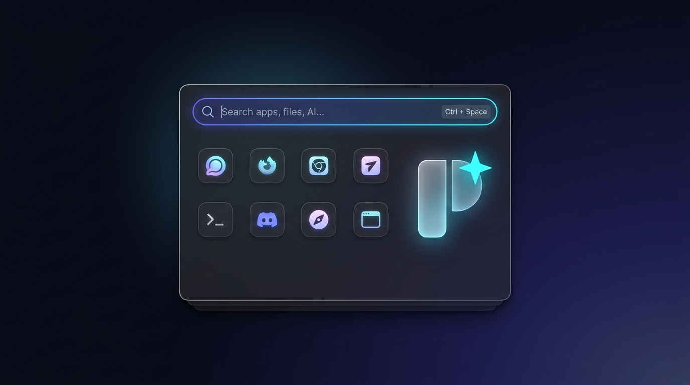
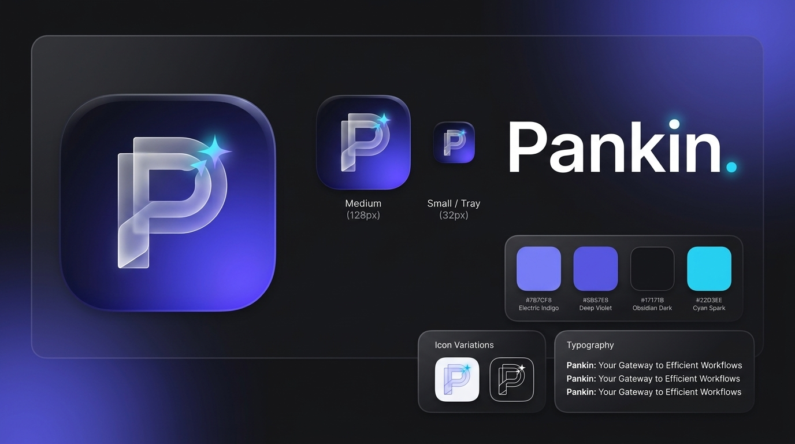
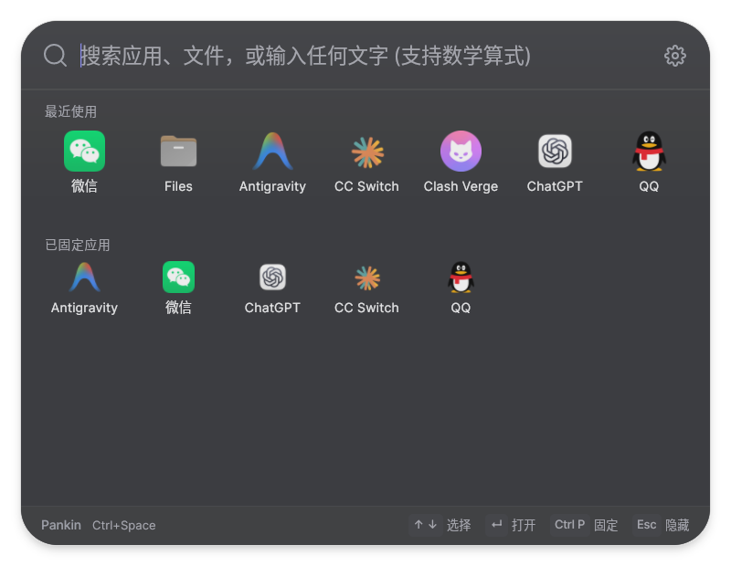
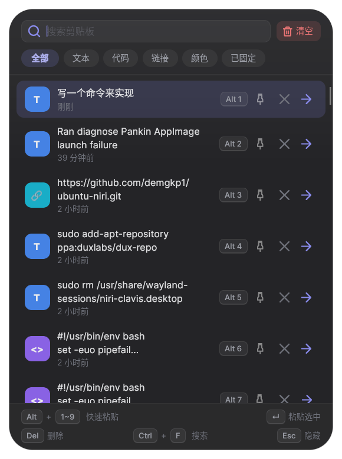
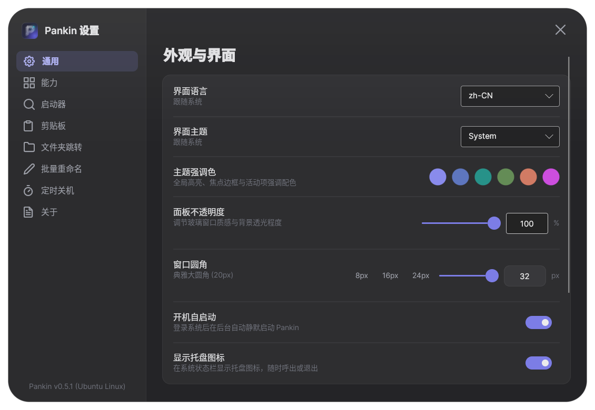

<div align="center">


# Pankin

**Native Modern Desktop Productivity Platform for Linux**  
专为 **Ubuntu 24.04 / 26.04 LTS** 与 **Wayland（GNOME / Niri）/ X11** 打造的原生现代桌面效率终端

<p>
  
  
  
  
  
  
</p>

<p>
  <a href="#-核心特性">核心特性</a> •
  <a href="#-视觉设计">视觉设计</a> •
  <a href="#-实机演示">实机演示</a> •
  <a href="#-安装与运行">安装与运行</a> •
  <a href="#-niri--wayland-常驻后台与快捷键">Niri / Wayland 指南</a> •
  <a href="#-架构与本地构建">本地构建</a>
</p>

<br/>



</div>

---

## 📖 项目介绍

**Pankin** 是一款基于 **.NET 8 / .NET 10** 与 **Avalonia 11** 构建的跨平台原生 Linux 桌面生产力工具。界面遵循自研的 **Graphite Glass（石墨毛玻璃）** 设计系统，将极速启动、持久化剪贴板、划词超级面板与流式 AI 助手整合于一体，兼顾低内存驻留与丝滑响应。

---

## ✨ 核心特性

<table>
  <tr>
    <td width="50%" valign="top">
      <h3>🚀 极速启动器 (Fast Launcher)</h3>
      <ul>
        <li><strong>智能拼音匹配</strong>：支持汉字全拼与首字母模糊检索（如输入 <code>wx</code> 瞬时命中 <code>微信</code>）。</li>
        <li><strong>活跃感知排序</strong>：本地实时记录启动频次与切换时间，异步无阻塞刷新「最近使用」列表。</li>
        <li><strong>固定磁贴</strong>：支持将高频应用与内置工具置顶为主屏磁贴。</li>
        <li><strong>双擎全盘搜</strong>：融合 <code>.desktop</code> / <code>AppImage</code> 应用索引与 <code>plocate</code> 极速文件检索。</li>
        <li><strong>算式与系统指令</strong>：即时计算数学表达式，内置关机 / 重启倒计时与终端命令历史。</li>
      </ul>
    </td>
    <td width="50%" valign="top">
      <h3>📋 剪贴板历史 (Clipboard History)</h3>
      <ul>
        <li><strong>SQLite 持久化</strong>：轻量可靠的本地历史存储，支持文本与富文本快照。</li>
        <li><strong>检索与置顶</strong>：关键词即时过滤，支持常用片段置顶锁定。</li>
        <li><strong>一键回贴</strong>：回车即可粘贴回当前焦点窗口，兼容 Wayland 与 X11。</li>
        <li><strong>失焦自隐藏</strong>：焦点切换自动收起，保持桌面干净不打扰。</li>
      </ul>
    </td>
  </tr>
  <tr>
    <td width="50%" valign="top">
      <h3>✨ 划词智能超级面板 (Super Panel)</h3>
      <ul>
        <li><strong>AI 流式对话</strong>：兼容 OpenAI / Anthropic 接口格式，支持多轮流式对话。</li>
        <li><strong>一键划词翻译</strong>：选中文本后快速呼出，即时翻译并解释上下文。</li>
        <li><strong>快捷动作组</strong>：集成网页直达搜索、字数统计与大小写转换等实用动作。</li>
      </ul>
    </td>
    <td width="50%" valign="top">
      <h3>📁 目录穿梭 & 批量重命名</h3>
      <ul>
        <li><strong>FolderJump</strong>：快速跳转高频工作目录，直达终端或文件管理器。</li>
        <li><strong>BatchRenamer</strong>：可视化批量文件重命名，支持正则替换、序号递增与前后缀规则。</li>
        <li><strong>多桌面环境适配</strong>：原生适配 GNOME Wayland、Niri、Sway、Hyprland 与 X11 会话。</li>
      </ul>
    </td>
  </tr>
</table>

---

## 🎨 视觉设计

**Graphite Glass** 以深邃的黑曜石底色（`#17171B`）搭配电光靛紫（`#7B7CF8` / `#5B57E8`）与青色微光（`#22D3EE`），兼顾暗色/浅色主题与磨砂透明度调节。双层半透玻璃 **P** 徽标与启动器面板在桌面 Dock、系统托盘及高分屏下均保持清晰锐利的轮廓：

<div align="center">
  
</div>

---

## 📸 实机演示

以下截图均实拍自 **Ubuntu 26.04 LTS + Niri Wayland** 真实桌面环境（`Pankin v0.5.1`）：

<table>
  <tr>
    <td align="center" width="50%" valign="top">
      <strong>🚀 启动器主界面 (Fast Launcher)</strong><br/><br/>
      
    </td>
    <td align="center" width="50%" valign="top">
      <strong>📋 剪贴板历史 (Clipboard History)</strong><br/><br/>
      
    </td>
  </tr>
  <tr>
    <td align="center" colspan="2">
      <strong>⚙️ 设置中心 (Settings Center)</strong><br/><br/>
      
    </td>
  </tr>
</table>

---

## ⌨️ 默认全局快捷键

| 快捷键 | 功能 | 说明 |
| :--- | :--- | :--- |
| <kbd>Ctrl</kbd> + <kbd>Space</kbd> | **唤出 / 隐藏主启动器** | 应用启动、文件检索、算式计算与系统命令 |
| <kbd>Alt</kbd> + <kbd>V</kbd> | **唤出剪贴板历史** | 搜索并回车回贴历史复制内容 |
| <kbd>Alt</kbd> + <kbd>S</kbd> | **唤出划词超级面板** | 触发 AI 对话、划词翻译与快捷文本处理 |
| <kbd>Alt</kbd> + <kbd>,</kbd> | **打开设置中心** | 模块开关、外观主题、热键与 AI 模型配置 |

> 在 X11 / GNOME Wayland 下热键由程序自动接管，且均可在「设置中心」自定义；在 Niri 等独立 Wayland 合成器下请参照下文配置绑定。

---

## 📦 安装与运行

当前源码版本为 **0.5.1**，可前往 [GitHub Releases](https://github.com/demgkp1/Pankin/releases) 下载对应安装包，或按文末脚本本地打包。

### 1. 系统依赖

```bash
sudo apt update
sudo apt install -y plocate xclip wl-clipboard libnotify-bin libgdk-pixbuf-2.0-0 librsvg2-common
```

### 2. Debian 软件包安装（`.deb`，推荐）

```bash
sudo apt install ./pankin_0.5.1_amd64.deb
```

安装完成后即可在应用菜单启动 **Pankin**，或在终端直接运行 `pankin`。

### 3. AppImage 免安装运行

```bash
chmod +x Pankin-0.5.1-x86_64.AppImage
./Pankin-0.5.1-x86_64.AppImage
```

> **AppImage 使用建议**
> - 推荐固定存放在 `~/app/` 或 `~/Applications/`；启动器会自动扫描 `~/AppImages/`、`~/Downloads/`、`~/.local/bin/` 中的可执行 AppImage。
> - 开启「开机自启」后，新版路径会自动写入 `~/.config/autostart/pankin.desktop`（附加 `--autostart` 静默驻留参数）；移动 AppImage 位置后请从新路径启动一次以同步路径。

---

## 🪟 Niri / Wayland 常驻后台与快捷键

在 **Niri** 等独立 Wayland 合成器中，受限于 Wayland 按键安全隔离，建议由合成器负责开机后台拉起与全局快捷键触发。Pankin 已内置完整的**单实例跨进程通信**与**本地 UDP 快速唤起端口**。

### 1. 后台常驻启动

使用 `--autostart` 参数启动后，Pankin 会静默驻留后台与系统托盘（不主动弹出主面板）：

```bash
# .deb 安装版
pankin --autostart

# AppImage 免安装版
/path/to/Pankin-0.5.1-x86_64.AppImage --autostart
```

在 `~/.config/niri/config.kdl` 中添加开机自启：

```kdl
spawn-at-startup "pankin" "--autostart"
```

### 2. Niri 快捷键绑定 (`~/.config/niri/config.kdl`)

> **自动同步提示**：启动 Pankin 或在「设置中心」修改全局快捷键后，Pankin 会自动向 `~/.config/niri/config.kdl` 同步写入并更新 `// BEGIN PANKIN SHORTCUTS` 区块，随后自动重载 Niri 配置，无需每次手动调整。

如需手动查看或配置，可在 `binds { ... }` 中任选以下一种方式绑定快捷键：

```kdl
binds {
    // 方式 A：CLI 单实例唤起（推荐，即使后台尚未启动也会自动拉起 Pankin，与默认设置热键一致）
    Ctrl+Space { spawn "pankin" "--toggle"; }
    Alt+V { spawn "pankin" "--clipboard"; }
    Alt+S { spawn "pankin" "--superpanel"; }
    Alt+Comma { spawn "pankin" "--settings"; }

    // 方式 B：直连内置后台 UDP 端口（零进程启动延迟，需 Pankin 已在后台常驻）
    // Ctrl+Space { spawn "bash" "-c" "printf 'ToggleLauncher' > /dev/udp/127.0.0.1/49182"; }
}
```

### 3. CLI 控制参数一览

| 参数 | 功能说明 |
| :--- | :--- |
| `--autostart` | 静默启动并常驻后台，不自动弹出主面板 |
| `--toggle` | 切换显示 / 隐藏主启动器（未启动时自动拉起） |
| `--show` | 唤出并聚焦主启动器 |
| `--clipboard` | 切换剪贴板历史窗口 |
| `--superpanel` | 唤出智能超级面板 |
| `--settings` | 打开系统设置中心 |
| `--exit` | 优雅退出后台常驻实例 |

---

## 🛠️ 架构与本地构建

Pankin 采用严格的三层解耦架构，全部基于跨平台 .NET 与 Linux 原生接口实现：

```text
Pankin.sln
├── src/Pankin.Core                  # 跨平台核心业务（启动检索、拼音匹配、AI 流式对话、SQLite 剪贴板、单实例 IPC）
├── src/Pankin.Platform.Linux        # Linux 系统适配（XDG 扫描、plocate、Wayland/X11 剪贴板、Niri/Sway/Hyprland/X11 窗口探测）
├── src/Pankin.Desktop               # Avalonia 11 UI 桌面端（Graphite Glass 视觉系统、托盘常驻）
├── tests/Pankin.Core.Tests          # 核心业务单元测试（379 Tests）
├── tests/Pankin.Linux.Tests         # Linux 平台回归测试（80 Tests）
└── tests/Pankin.Launcher.Verification # GUI 与图标渲染集成验证
```

### 环境要求

* **操作系统**：Ubuntu 22.04 / 24.04 / 26.04 LTS（或主流 `x86_64` Linux 发行版）
* **.NET SDK**：[.NET 8.0 SDK](https://dotnet.microsoft.com/download/dotnet/8.0) 或 [.NET 10.0 SDK](https://dotnet.microsoft.com/download/dotnet/10.0)（通过 `Directory.Build.props` 自动适配）

### 构建、测试与打包

```bash
# 1. 克隆仓库
git clone https://github.com/demgkp1/Pankin.git
cd Pankin

# 2. 构建与测试
dotnet build Pankin.sln
dotnet test Pankin.sln

# 3. 本地运行桌面端
dotnet run --project src/Pankin.Desktop

# 4. 一键打包自包含 .deb 与 .AppImage
bash scripts/package-linux.sh
```

打包产物将输出至 `artifacts/` 目录：
* `artifacts/pankin_0.5.1_amd64.deb`
* `artifacts/Pankin-0.5.1-x86_64.AppImage`
* `artifacts/SHA256SUMS.txt`
* `artifacts/pankin.svg` / `artifacts/pankin.png`

> 更多运行时与打包说明请参阅 [Linux 运行时回归验证](docs/linux-runtime-regressions.md) 与 [GitHub 发布指南](docs/github-release.md)。

---

## 📄 License

本项目基于 [MIT License](LICENSE) 开源。
